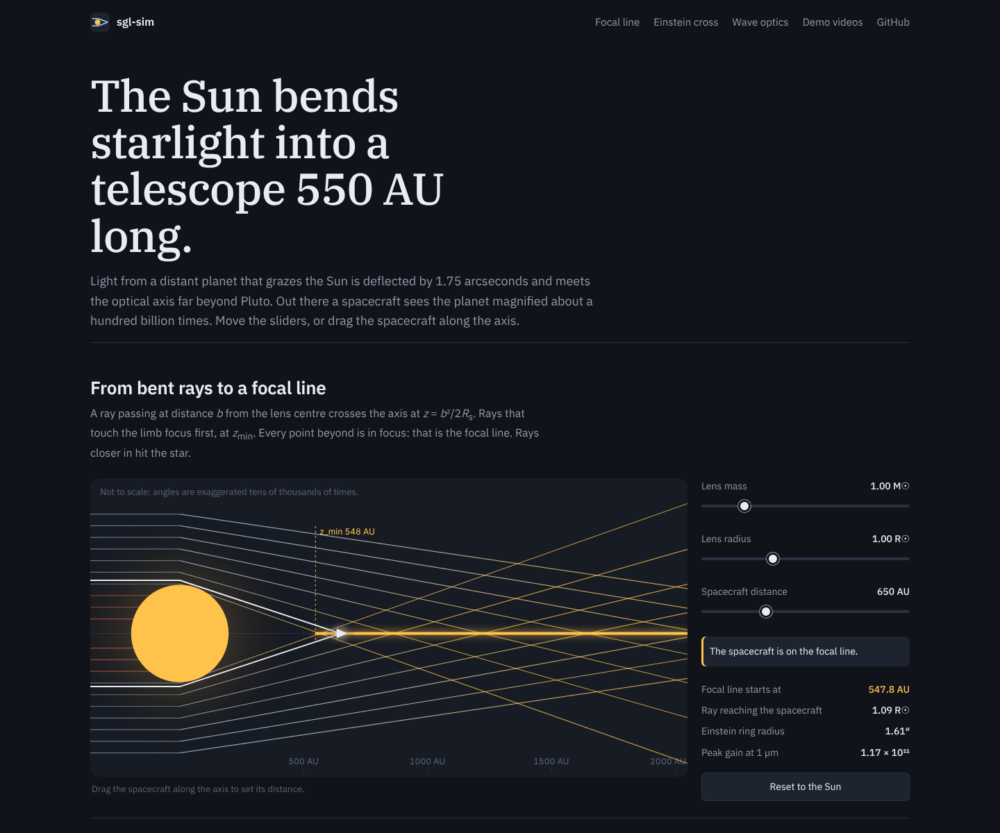
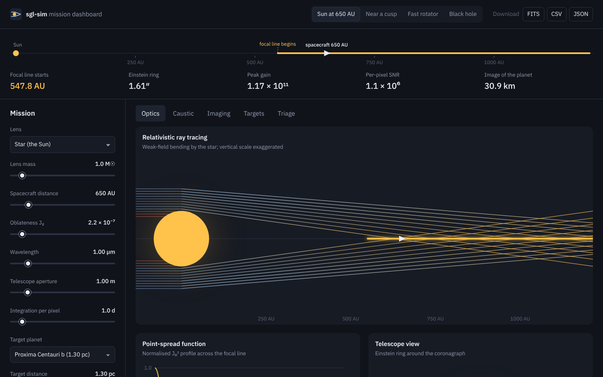
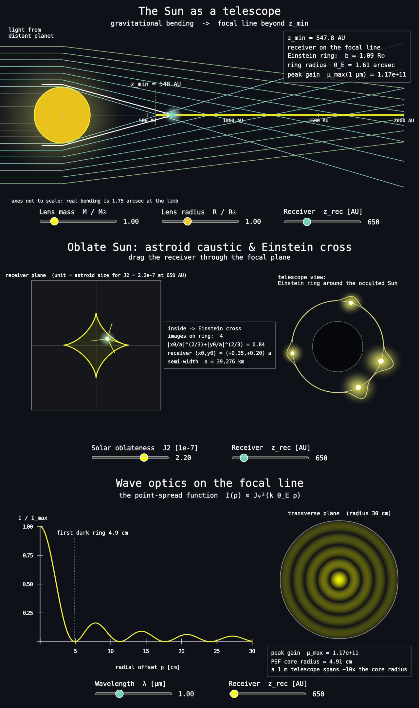

# sgl-sim: Gravitational Lens Telescopes & Mission Design Simulator

[](https://github.com/teom275/sgl-sim)
[](paper/paper.md)
[](LICENSE)
[](pyproject.toml)
[](https://www.astropy.org/)
[](https://orcid.org/0009-0008-8025-8576)
[](https://github.com/teom275/sgl-sim)

**`sgl-sim`** is an open-source Python package and set of interactive simulators for designing **gravitational lens telescope missions**. The Sun bends the light of a distant planet onto a focal line that starts about 548 AU away. A spacecraft there sees the planet magnified about 10¹¹ times. `sgl-sim` models that lens, from ray bending to the reconstructed image of the planet, and also covers black-hole lenses.

| | |
|---|---|
| **Web simulator** | <https://teom275.github.io/sgl-sim/>: runs in the browser, no install, in English or [Spanish](https://teom275.github.io/sgl-sim/?lang=es) |
| **Mission dashboard** | Flask app, run it locally or [deploy it to Render](#mission-dashboard) |
| **Python API** | [`docs/python-api.md`](docs/python-api.md): examples and module reference |
| **Paper** | [`paper/paper.md`](paper/paper.md) (JOSS draft) |



> **Model under review.** A [physics audit](docs/auditoria-fisica.md) (in Spanish) checked sgl-sim against the SGL literature. Fixed so far: caustic size, corona, proper motion, catalogue data, the photon budget, a physical image simulator (SGL blur matrix, corona noise, reconstruction) and planet rotation during the scan. Still pending: the motion of the image across the focal plane, the trajectory model and the target score, so treat the ranking as provisional.

---

## What it models

- **Relativity:** Schwarzschild radius, photon sphere and critical impact parameter ($b_c = \tfrac{3\sqrt{3}}{2} R_s$), weak-field deflection, axis crossing $z(b) = b^2/2R_s$, and RK45 integration of strong-field null geodesics.
- **Wave optics:** minimum focal distance ($z_{\min} \approx 547.8$ AU for the Sun), Einstein ring, peak gain $\mu_{\max} = 4\pi^2 R_s/\lambda \sim 10^{11}$, and the Bessel $J_0^2$ point-spread function, whose core is about 5 cm wide at 650 AU.
- **Oblateness caustics ($J_2$):** astroid caustic in the receiver plane, a few hundred metres across for the Sun and scaled by the orientation of the solar spin axis ($\sin^2\beta_s$), and a solver for the quadrupole lens equation. It gives four images (Einstein cross) inside the astroid and two outside.
- **Imaging:** photon budget of an extended source through the lens (direct signal, blur from the whole disk, Baumbach K-corona in the Einstein-ring annulus; `sgl_sim.radiometry`), integration time for a target SNR, and 2D Wiener deconvolution of a synthetic exoplanet albedo map.
- **Orbits and station keeping:** focal-line hover Δv, scan Δv, image-cylinder size, and black-hole ISCO.
- **Targets:** resolver for the NASA Exoplanet Archive (TAP, with a curated offline catalogue of 15 targets). It returns the antipodal telescope pointing, 3D heliocentric position, ecliptic inclination, light delay and proper-motion drift.
- **Triage:** 0–100 feasibility score and mission tier, all-sky efficiency map, multi-target co-alignment check, and rotational motion blur for one spacecraft vs. a swarm.
- **Image simulation:** `sgl_sim.imaging.simulate_sgl_observation` models a rotating planet scanned by N telescopes. It includes the 1/ρ SGL blur on D/N pixels, corona photon noise and reconstruction, and reports the swarm size or aperture needed for a sharp image.
- **Reference bodies:** cloud-free Earth and schematic Moon albedo maps (global, so they can rotate) (`earth_albedo_map`, `moon_albedo_map`) that plug into any imaging routine as `ground_truth`.
- **Export:** multi-extension FITS (`CAUSTIC_MAP`, `RAW_DETECTOR`, `DECONV_EXO`, `PSF_PROFILE`), CSV and JSON.

---

## Best targets for a solar-lens telescope

The best candidates come from `sgl_sim.get_ranked_catalog()`, which scores a curated set of nearby planets for a spacecraft at 650 AU. Each score combines four factors:
- photon SNR (30 %)
- scan logistics (25 %)
- ecliptic access, which drives launch cost (25 %)
- immunity to rotational blur (20 %)

| # | Planet | Distance | Ecliptic lat. | Planet image | Telescope points to | Score | Tier |
|---|---|---|---|---|---|---|---|
| 1 | Wolf 1061 c | 4.31 pc | -9.1° | 15.5 km | Taurus | **91.6** | Tier 1 |
| 2 | Ross 128 b | 3.37 pc | +0.5° | 13.2 km | Pisces | **90.8** | Tier 1 |
| 3 | Luyten b | 3.80 pc | +16.5° | 12.5 km | Aquila | **85.8** | Tier 1 |
| 4 | Tau Ceti e | 3.65 pc | +24.8° | 19.8 km | Boötes | **84.8** | Tier 1 |
| 5 | Teegarden's Star b | 3.83 pc | -0.3° | 11.0 km | Libra | **84.3** | Tier 1 |
| 6 | LHS 1140 b | 14.99 pc | +18.5° | 4.6 km | Coma Berenices | **79.9** | Tier 1 |
| 7 | TRAPPIST-1 f | 12.43 pc | -0.6° | 3.4 km | Leo | **79.3** | Tier 1 |
| 8 | TRAPPIST-1 e | 12.43 pc | -0.6° | 3.0 km | Leo | **78.2** | Tier 1 |
| 9 | Proxima Centauri b | 1.30 pc | +44.8° | 31.8 km | Cassiopeia | **77.6** | Tier 1 |
| 10 | TRAPPIST-1 d | 12.43 pc | -0.6° | 2.5 km | Leo | **76.8** | Tier 1 |
| 11 | TOI-700 d | 31.13 pc | +86.9° | 1.5 km | Draco | **47.8** | Tier 3 |
| 12 | Kepler-186 f | 178.50 pc | -62.8° | 0.3 km | Puppis | **38.9** | Tier 3 |

"Planet image" is the diameter of the planet's image at the focal line, which is the area the spacecraft must scan. Tier 1 targets suit a single craft or a swarm. Tier 3 targets sit far from the ecliptic and need a costly launch. The [web simulator's mission planner](https://teom275.github.io/sgl-sim/#targets) opens a full mission profile for each planet:
- where to send the spacecraft (pointing, heliocentric position, distance from the ecliptic, all-sky map)
- the trip (cruise time, signal delay, image size, drift, scan Δv)
- the imaging requirements, from a physical simulation: exposure per pixel, scan time, how many 1 m telescopes keep a 32 × 32 or 64 × 64 image sharp while the planet rotates, and the minimum aperture when no swarm suffices. A toggle swaps in the surface of the **Earth or the Moon**, keeping the target's distance, rotation and noise, as a reference for image quality.
- the score breakdown
- which other targets share the trajectory

The dashboard's **Triage** tab can also score any planet you enter.

```python
from sgl_sim import get_ranked_catalog, score_exoplanet_candidate

for r in get_ranked_catalog(z_rec_au=650.0)[:3]:
    print(r["name"], r["sgl_score"], r["tier"])
```

---

## Installation

Requires Python 3.9 or newer. CI tests 3.10–3.12.

```bash
git clone https://github.com/teom275/sgl-sim.git
cd sgl-sim
python3 -m venv .venv
source .venv/bin/activate
pip install -e ".[test]"
```

Optional extras:

| Extra | Adds | Needed for |
|---|---|---|
| `test` | pytest, pytest-cov | running the test suite |
| `server` | gunicorn | serving the dashboard in production (Render) |
| `manim` | ManimGL and compatibility shims | the interactive desktop scenes and demo videos |

---

## Python API

```python
from astropy import units as u
from sgl_sim import minimum_focal_distance, einstein_ring_properties, solve_quadrupole_images

print(minimum_focal_distance(mass=1 * u.M_sun, radius=1 * u.R_sun)["z_min_au"])      # 547.76 AU
print(einstein_ring_properties(z_rec=650 * u.AU)["theta_E_arcsec"])                  # 1.61 arcsec
print(solve_quadrupole_images(x0=0 * u.m, y0=0 * u.m, z_rec=650 * u.AU)["num_images"])  # 4
```

Functions accept SI floats or `astropy.units` quantities and return dictionaries of named results. The full walkthrough is in **[`docs/python-api.md`](docs/python-api.md)**. It covers deflection, the PSF, caustics, deconvolution, FITS export, target ephemerides and triage, plus a table of every module.

---

## Web simulator

The static site in [`docs/`](docs/) runs entirely in the browser. It contains:
- the focal line, with a draggable spacecraft
- the astroid caustic and Einstein cross
- the wave-optics PSF
- the mission planner for the 12 ranked targets
- the ManimGL demo videos

It is available in English and Spanish. Use the language button in the header, or add `?lang=es` to the URL. The page also remembers the last choice. Translations live in [`docs/sim/i18n.js`](docs/sim/i18n.js).

[`docs/sim/physics.js`](docs/sim/physics.js) is a JavaScript port of the `sgl_sim` formulas and gives the same numbers as the Python API.

- **Publish:** in the repository settings, open *Pages* and deploy from the `main` branch, `/docs` folder.
- **Link the dashboard:** set `DASHBOARD_URL` in [`docs/sim/config.js`](docs/sim/config.js).
- **Refresh the mission data:** the planner has no server, so `python scripts/export_site_targets.py` precomputes everything with the Python API: ranking, deployment geometry, single vs. swarm blur, co-alignment and the sky map. Re-run it after changing the catalogue or the models. A test fails if `docs/sim/targets.json` is stale.

---

## Mission dashboard



A Flask web app for designing a mission. Every number comes from the Python API.

```bash
sgl-sim-server --host 127.0.0.1 --port 5000      # or: python -m sgl_sim.web.app
```

Then open `http://127.0.0.1:5000`.

- **Optical-axis ruler:** shows the Sun, where the focal line begins and where the spacecraft sits. Below it are z_min, the Einstein ring, peak gain, per-pixel SNR and the planet image size.
- **Optics:** weak-field rays for a star or strong-field geodesics around a black hole, the J₀² PSF profile, and the telescope view of the Einstein ring.
- **Caustic:** drag the spacecraft across the J₂ astroid and watch four images become two.
- **Imaging:** ground truth → detector → Wiener reconstruction, and the SNR trade across distance × aperture.
- **Targets:** resolve a planet and get the telescope pointing, heliocentric position, light delay and drift.
- **Triage:** all-sky efficiency map, scoring with a co-alignment check, one craft vs. a swarm, and the ranked catalogue.
- **Downloads:** FITS, CSV and JSON of the current scenario.

### Deploy to Render

[](https://render.com/deploy?repo=https://github.com/teom275/sgl-sim)

[`render.yaml`](render.yaml) is a blueprint for Render's free plan. It installs `.[server]` and runs `gunicorn sgl_sim.web.app:app`, then redeploys on every push to `main`. On the free plan the service sleeps when idle, so the first request after a pause takes about a minute. To run the same server elsewhere:

```bash
pip install ".[server]"
gunicorn --bind 0.0.0.0:8000 sgl_sim.web.app:app
```

---

## Interactive ManimGL scenes (3Blue1Brown `manim`)



`sgl_sim.manim_scenes` holds three interactive scenes built on [ManimGL](https://github.com/3b1b/manim), the animation engine 3Blue1Brown uses for its videos. Each scene first plays a short animated demo. After that the window stays open and every control is live. All the numbers come from the regular `sgl_sim` API.

```bash
pip install -e ".[manim]"          # ManimGL + small compatibility shims

manimgl src/sgl_sim/manim_scenes/sgl_interactive.py SolarLensFocalLine
manimgl src/sgl_sim/manim_scenes/sgl_interactive.py EinsteinCrossExplorer
manimgl src/sgl_sim/manim_scenes/sgl_interactive.py WavePSFExplorer
```

| Scene | What you can do |
|---|---|
| `SolarLensFocalLine` | Drag the lens mass, lens radius and receiver distance. Rays cross the axis at $z(b) = b^2 / 2R_s$, the focal line starts at $z_{\min}$, and the Einstein-ring ray pair that reaches the spacecraft is highlighted. Readouts show $\theta_E$ and $\mu_{\max}$. |
| `EinsteinCrossExplorer` | Drag the receiver (or click anywhere) in the focal plane. The $J_2$ astroid caustic grows and shrinks with $J_2$ and $z_{\text{rec}}$. The telescope view shows the 4 → 2 image transition (Einstein cross) and the azimuthal brightness of the ring. |
| `WavePSFExplorer` | Change the wavelength and $z_{\text{rec}}$ to see the $J_0^2$ PSF profile, a 2D transverse-plane image, the radius of the first dark ring (about 5 cm at 650 AU and 1 µm) and the peak gain. |

Useful ManimGL flags:
- `-w` renders the demo to an MP4 without opening a window.
- `-s` saves only the final frame.
- `-l` / `-m` render at lower resolution.
- `-e` opens an IPython shell on the live scene (e.g. `self.s_mass.set_value(2.0)`).

No LaTeX installation is needed. The drawing geometry lives in `sgl_sim/manim_scenes/model.py`, which is pure NumPy and is tested in `tests/test_manim_model.py`.

---

## Repository layout

| Path | Contents |
|---|---|
| `src/sgl_sim/` | Physics modules (relativity, optics, caustics, deconvolution, orbital, tradespace, targets, triage, reference bodies, exporters) |
| `src/sgl_sim/web/` | Flask dashboard: `app.py` (API), `templates/`, `static/` |
| `src/sgl_sim/manim_scenes/` | ManimGL scenes and their NumPy geometry |
| `docs/` | GitHub Pages site (web simulator, demo videos) and [`python-api.md`](docs/python-api.md) |
| `tests/` | pytest suite |
| `scripts/` | `export_site_targets.py` (precomputed mission data for the site), `generate_preview.py` (static matplotlib preview) |
| `paper/` | JOSS manuscript and bibliography |
| `ci/` | GitHub Actions workflow for tests and the JOSS paper build |
| `render.yaml` | Render deployment blueprint |

---

## Running the tests

```bash
pytest -v --cov=sgl_sim --cov-report=term-missing tests/
```

The suite checks the physics benchmarks:
- $z_{\min} \approx 547.8$ AU
- black-hole capture at $b \le b_c \approx 2.598 R_s$
- the four-image Einstein cross inside the $J_2$ astroid
- RMSE/SSIM improvement from Wiener deconvolution
- valid multi-extension FITS files

It also covers:
- the target resolver and triage scoring
- the Flask API, including valid JSON for every preset
- the Earth/Moon reference maps
- the ManimGL scene geometry
- that the web simulator's mission data matches the Python API

---

## Citation

If you use `sgl-sim` in your research, mission design studies, or educational activities, please cite the JOSS manuscript and software repository:

### BibTeX
```bibtex
@software{Maggio2026_sglsim,
  author = {Maggio, Teo},
  title = {sgl-sim: Scientific Mission Design & Wave Optics Simulator for Gravitational Lens Telescopes},
  year = {2026},
  howpublished = {\url{https://github.com/teom275/sgl-sim}},
  note = {Journal of Open Source Software (in review / submission draft)}
}
```

**Lead Author:** Teo Maggio ([ORCID: 0009-0008-8025-8576](https://orcid.org/0009-0008-8025-8576))

---

## License

This project is licensed under the MIT License — see the [LICENSE](LICENSE) file for details.
