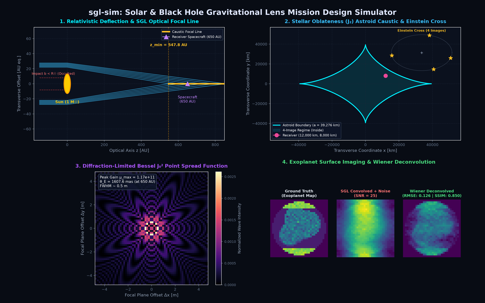

# sgl-sim: Gravitational Lens Telescopes & Mission Design Simulator

[](https://github.com/teom275/sgl-sim/actions)
[](paper/paper.md)
[](LICENSE)
[](pyproject.toml)
[](https://www.astropy.org/)
[](https://github.com/teom275/sgl-sim)

**`sgl-sim`** is an open-source, peer-review-ready scientific Python package and interactive mission-design simulator for **Gravitational Lens Telescopes (Solar & Black Hole Focal Line Missions)**. 

Adhering strictly to **Journal of Open Source Software (JOSS)** and **Astropy package** standards, `sgl-sim` models:
- **Relativistic Null Geodesics:** Schwarzschild metrics, critical photon capture parameters ($b_c = \frac{3\sqrt{3}}{2} R_s$), weak-field deflections, and RK45 numerical null geodesic integration.
- **Wave Optics & Focal Line Properties:** Finite diffraction-limited Bessel $J_0^2$ point spread functions (PSF), on-axis peak wave magnifications ($\mu_{\max} \sim 10^{11}$), and minimum focal distances ($z_{\min} \approx 547.8\text{ AU}$ for the Sun).
- **Stellar Oblateness Caustics ($J_2$):** Analytical and numerical solvers for the quadrupolar lens equation, predicting transverse astroid caustics, 4-image Einstein Cross configurations, cusp arcs, and fold bifurcations.
- **Noise Modeling & Exoplanet Deconvolution:** Baumbach-Allen solar K-coronal brightness backgrounds, per-pixel SNR budgets, and 2D Fourier-space Wiener deconvolution for surface albedo recovery.
- **Orbital Mechanics & Station-Keeping:** Focal-line hovering $\Delta v$, Keplerian orbital velocities, black hole ISCO checks, and image cylinder scan budgets.
- **Multi-Extension FITS Exporters:** NASA/Astropy compliant `.fits` files (`CAUSTIC_MAP`, `RAW_DETECTOR`, `DECONV_EXO`, and binary table `PSF_PROFILE`).
- **Interactive Dark-Mode Mission Dashboard:** Real-time synchronized 4-panel web application.

---

## Installation

### Prerequisites
- Python 3.9, 3.10, 3.11, or 3.12
- Standard virtual environment (`venv` or `conda`)

### Install from Source
```bash
git clone https://github.com/teom275/sgl-sim.git
cd sgl-sim

# Create virtual environment
python3 -m venv .venv
source .venv/bin/activate

# Install in editable mode with test dependencies
pip install -e ".[test]"
```

---

## Python API Quickstart

### 1. Relativistic Deflection & Minimum Focal Distance
```python
from astropy import units as u
from sgl_sim import (
    schwarzschild_radius,
    critical_impact_parameter,
    minimum_focal_distance,
    focal_distance
)

# Calculate Schwarzschild radius & photon capture threshold
rs_sun = schwarzschild_radius(1.0 * u.M_sun)
b_crit = critical_impact_parameter(1.0 * u.M_sun)
print(f"Solar R_s: {rs_sun:.2f} m | Critical b_c: {b_crit:.2f} m")

# Minimum focal crossing distance for grazing solar rays
z_min_info = minimum_focal_distance(mass=1.0 * u.M_sun, radius=1.0 * u.R_sun)
print(f"Solar Gravitational Lens z_min: {z_min_info['z_min_au']:.2f} AU")
# Output: Solar Gravitational Lens z_min: 547.76 AU
```

### 2. Wave-Optics Bessel PSF & Peak Magnification
```python
from sgl_sim import (
    einstein_ring_properties,
    peak_magnification,
    psf_intensity,
    generate_2d_psf
)

z_rec = 650.0 * u.AU
wavelength = 1.0 * u.micron

# Einstein ring angular radius and peak wave magnification
ring = einstein_ring_properties(z_rec=z_rec)
mu_max = peak_magnification(wavelength=wavelength)
print(f"θ_E: {ring['theta_E_arcsec'] * 1000:.2f} mas | μ_max: {mu_max:.2e}")

# Generate 2D normalized Bessel J_0^2 PSF kernel
psf_kernel_2d = generate_2d_psf(grid_size=32, pixel_scale_m=1.0 * u.m, z_rec=z_rec, wavelength=wavelength)
```

### 3. Stellar Oblateness ($J_2$) Astroid Caustics & Einstein Cross
```python
from sgl_sim import astroid_caustic_semi_width, solve_quadrupole_images

# Astroid semi-width at 650 AU
caustic = astroid_caustic_semi_width(z_rec=650.0 * u.AU, j2=2.2e-7)
print(f"Astroid Semi-Width: {caustic['a_caustic_m']:.2f} m")

# Receiver inside astroid at (x0, y0) = (0.0, 0.0) m -> 4 images (Einstein Cross)
sol_inside = solve_quadrupole_images(x0=0.0 * u.m, y0=0.0 * u.m, z_rec=650.0 * u.AU)
print(f"Regime: {sol_inside['regime']} | Resolved Images: {sol_inside['num_images']}")
print(f"Image Angles (deg): {[round(deg, 1) for deg in sol_inside['image_angles_deg']]}")
```

### 4. 2D Wiener Deconvolution Pipeline
```python
from sgl_sim import generate_exoplanet_map, wiener_deconvolution, calculate_snr

# Calculate per-pixel SNR for 1m telescope, 1-day integration
snr_budget = calculate_snr(z_rec=650.0 * u.AU, aperture_m=1.0 * u.m)
snr = snr_budget["snr"]
print(f"Per-pixel SNR: {snr:.1f}")

# Generate ground truth exoplanet map (continents + oceans + polar caps)
ground_truth = generate_exoplanet_map(grid_size=32, seed=42)

# Deconvolve blurred + noise-degraded image
result = wiener_deconvolution(ground_truth=ground_truth, psf_kernel=psf_kernel_2d, snr=snr)
print(f"Noisy RMSE: {result['rmse_noisy']:.4f} -> Deconvolved RMSE: {result['rmse_deconvolved']:.4f}")
print(f"Reconstructed SSIM: {result['ssim_deconvolved']:.4f}")
```

### 5. NASA Multi-Extension FITS Export
```python
from sgl_sim import export_fits

# Export complete simulation metadata, 2D images, and radial PSF to standard FITS
fits_path = export_fits(
    sim_data={
        "mass_solar": 1.0,
        "z_rec_au": 650.0,
        "j2": 2.2e-7,
        "wavelength_m": 1.0e-6,
        "snr": snr,
        "convolved_noisy": result["convolved_noisy"],
        "deconvolved": result["deconvolved"],
        "psf_rho_m": [0.0, 10.0, 20.0, 30.0],
        "psf_intensity": [1.0, 0.45, 0.08, 0.02],
    },
    output_path="sgl_mission_run.fits"
)
print(f"Saved NASA-standard FITS file to {fits_path}")
```

---

## Interactive Web Mission Dashboard



`sgl-sim` provides a synchronized, dark-mode astrophysical dashboard:

```bash
# Launch server via CLI entry point
sgl-sim-server --host 127.0.0.1 --port 5000

# Or via Python module execution
python -m sgl_sim.web.app
```

Then navigate to `http://127.0.0.1:5000` in your web browser.

### Key Interactive Features:
1. **Panel 1 — Relativistic Ray-Tracing Canvas:** Real-time ray tracing around the Sun or a Schwarzschild Black Hole, displaying the photon sphere, grazing rays, stellar occultation, and the golden caustic focal line.
2. **Panel 2 — Transverse Astroid Caustic Explorer:** Interactive 2D focal-plane canvas where dragging the receiver satellite $(x_0, y_0)$ inside or outside the astroid caustic dynamically transitions the system between 4-image Einstein Cross, cusp arc, and 2-image regimes.
3. **Panel 3 — Telescope Detector Viewport & Wave PSF:** Occulting coronagraph mask, Baumbach-Allen coronal glow, resolved Einstein Ring, and high-resolution radial Bessel $J_0^2$ diffraction profile.
4. **Panel 4 — Exoplanet Deconvolution & Tradespace Heatmap:** 3-stage visualizer (Ground Truth $\to$ Noisy Detector $\to$ Wiener Reconstruction) and $(z_{\text{rec}}, D_{\text{tel}})$ mission tradespace contours.
5. **Scientific Export Bar:** Single-click downloads of `.fits`, `.csv`, and `.json` files.

---

## Running Automated Tests

Run the complete test suite with coverage reporting:

```bash
pytest -v --cov=sgl_sim --cov-report=term-missing tests/
```

All tests verify core astrophysical benchmarks:
- Solar minimum focal distance $z_{\min} \approx 547.8\text{ AU}$
- Black hole critical capture at $b \le b_c \approx 2.598 R_s$
- Quadrupolar 4-image Einstein Cross solutions inside $J_2$ astroid
- Wiener deconvolution RMSE reduction and SSIM improvement
- Valid multi-extension FITS file generation (`astropy.io.fits`)

---

## Citation

If you use `sgl-sim` in your research, mission design studies, or educational activities, please cite the JOSS manuscript and software repository:

### BibTeX
```bibtex
@software{Maggio2026_sglsim,
  author = {Maggio, Teo},
  title = {sgl-sim: Scientific Mission Design & Wave Optics Simulator for Gravitational Lens Telescopes},
  year = {2026},
  howpublished = {\url{https://github.com/teom275/sgl-sim}},
  note = {Journal of Open Source Software (in review / submission draft)}
}
```

---

## License

This project is licensed under the MIT License — see the [LICENSE](LICENSE) file for details.
